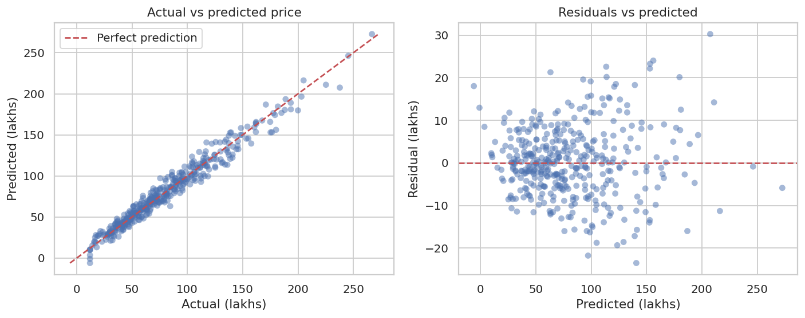

# 🏠 House Price Prediction using Multiple Linear Regression

A complete, reproducible predictive-analysis project that builds and tests a **Multiple Linear Regression** model to predict house prices (in ₹ lakhs) from property size, location, age and amenities.



## 📌 Highlights

- End-to-end pipeline: data cleaning → EDA → feature engineering → modelling → evaluation → diagnostics → prediction
- Leak-free scikit-learn `Pipeline` (imputation, scaling and encoding are learned from training data only)
- Evaluated with a hold-out test set **and** 5-fold cross-validation, against a naive baseline
- Regression assumptions checked (Durbin-Watson, Breusch-Pagan, Q-Q plot, VIF) and honestly reported
- Interpretable output: standardized coefficients show what drives price
- Includes a walkthrough Jupyter notebook and a command-line prediction tool

## 📊 Results

| Metric | Train | Test (unseen data) |
|---|---|---|
| R² | 0.941 | **0.965** |
| Adjusted R² | 0.940 | 0.964 |
| MAE (₹ lakhs) | 6.70 | **6.34** |
| RMSE (₹ lakhs) | 10.34 | **8.27** |
| MAPE | 10.4% | 9.8% |

- **5-fold cross-validation R²:** 0.945 ± 0.018
- **Naive baseline** (always predict the average price): RMSE 44.4 lakhs, so the model's error is ~81% lower.
- Train and test scores are close, so the model is **not overfitting**.

### Improvement from feature engineering

Price per sq ft differs by locality, so an **area × locality interaction** was added:

| Model | Test R² | Test RMSE | CV R² |
|---|---|---|---|
| Linear regression (no interaction) | 0.924 | 12.19 | 0.909 |
| **Linear regression (with interaction)** | **0.965** | **8.27** | **0.945** |

### Key price drivers
Area (especially in Prime localities), furnishing level and distance from the city centre have the biggest influence. See `outputs/coefficients.csv` and `outputs/figures/06_feature_coefficients.png`.

### Limitations (assumption checks)
- Durbin-Watson ≈ 2.03 → no autocorrelation ✅
- Breusch-Pagan p ≈ 0.006 → mild heteroscedasticity (errors grow slightly for expensive houses) ⚠️
- Residuals are slightly heavy-tailed (Shapiro-Wilk p < 0.05) ⚠️
- High VIF for area and interaction terms is structural (they are built from each other) and does not harm prediction accuracy ⚠️

## 🗂️ Project structure

```
house-price-prediction/
├── data/
│   ├── housing_data.csv          # dataset (2,010 rows x 13 columns)
│   └── DATA_DICTIONARY.md        # description of every column
├── src/
│   ├── generate_dataset.py       # reproducibly creates the dataset
│   ├── train_model.py            # full training + evaluation pipeline
│   └── predict.py                # predict price for a new house
├── notebooks/
│   └── house_price_prediction.ipynb   # step-by-step walkthrough with outputs
├── models/
│   └── linear_regression_model.joblib # trained model
├── outputs/
│   ├── figures/                  # all charts
│   ├── metrics.json              # all evaluation metrics
│   ├── coefficients.csv          # feature coefficients
│   ├── vif.csv                   # multicollinearity check
│   └── ols_summary.txt           # statsmodels OLS summary (p-values, CIs)
├── requirements.txt
├── LICENSE
└── README.md
```

## 🚀 How to run

```bash
# 1. (optional) create a virtual environment
python -m venv venv
source venv/bin/activate          # Windows: venv\Scripts\activate

# 2. install dependencies
pip install -r requirements.txt

# 3. (optional) regenerate the dataset
python src/generate_dataset.py

# 4. train and evaluate the model (creates figures, metrics and model file)
python src/train_model.py

# 5. predict the price of a new house
python src/predict.py --area 1500 --bedrooms 3 --locality Prime --distance 5

# 6. open the notebook walkthrough
jupyter notebook notebooks/house_price_prediction.ipynb
```

## 📁 About the dataset

`data/housing_data.csv` is a **synthetic dataset** generated by `src/generate_dataset.py` (fixed random seed, so it is fully reproducible). It models realistic Indian housing patterns (larger, newer, better-located homes cost more) and deliberately includes duplicates, missing values and outliers so that data cleaning is meaningful. See `data/DATA_DICTIONARY.md`.

**Using a real dataset instead:** put your CSV in `data/`, then edit the `CONFIG` block at the top of `src/train_model.py` (file path, `TARGET`, `NUMERIC_FEATURES`, `CATEGORICAL_FEATURES`). Popular real options: the *California Housing* dataset, *Ames Housing* or *Indian house price* datasets on Kaggle. Interaction features in `add_features()` may need adjusting for your columns.

## 🛠️ Tech stack

Python · pandas · NumPy · scikit-learn · statsmodels · SciPy · Matplotlib · Seaborn · Jupyter

## 🔭 Future work

- Compare against Ridge / Lasso regression and tree-based models (Random Forest, Gradient Boosting)
- Weighted least squares to address heteroscedasticity
- Train on real market data and deploy as a small Streamlit web app

## 📄 License

Released under the [MIT License](LICENSE).
